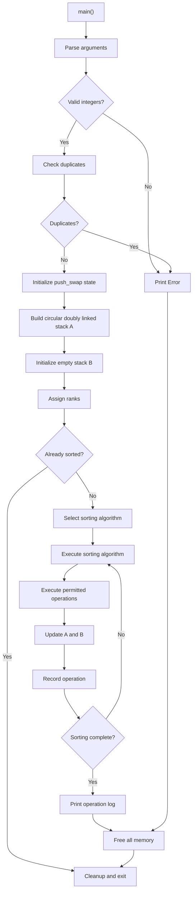

push_swap/
│
├── Makefile
├── push_swap.h
│
├── src/
│   │
│   ├── main.c
│   │
│   ├── input/
│   │   ├── parse_input.c
│   │   ├── parse_number.c
│   │   ├── validate_input.c
│   │   └── input_utils.c
│   │
│   ├── initialization/
│   │   ├── init_stack.c
│   │   ├── init_nodes.c
│   │   └── rank_compression.c
│   │
│   ├── stack/
│   │   ├── stack_create.c
│   │   ├── stack_destroy.c
│   │   ├── stack_push.c
│   │   ├── stack_pop.c
│   │   ├── stack_swap.c
│   │   ├── stack_rotate.c
│   │   ├── stack_reverse_rotate.c
│   │   └── stack_utils.c
│   │
│   ├── operations/
│   │   ├── op_swap.c
│   │   ├── op_push.c
│   │   ├── op_rotate.c
│   │   ├── op_reverse_rotate.c
│   │   ├── op_execute.c
│   │   └── op_log.c
│   │
│   ├── sorting/
│   │   ├── sort.c
│   │   ├── sort_small.c
│   │   ├── sort_radix.c
│   │   ├── sort_turk.c
│   │   └── sort_utils.c
│   │
│   ├── output/
│   │   └── print_operations.c
│   │
│   └── utils/
│       ├── error.c
│       ├── free_all.c
│       └── is_sorted.c
│
└── libft/

